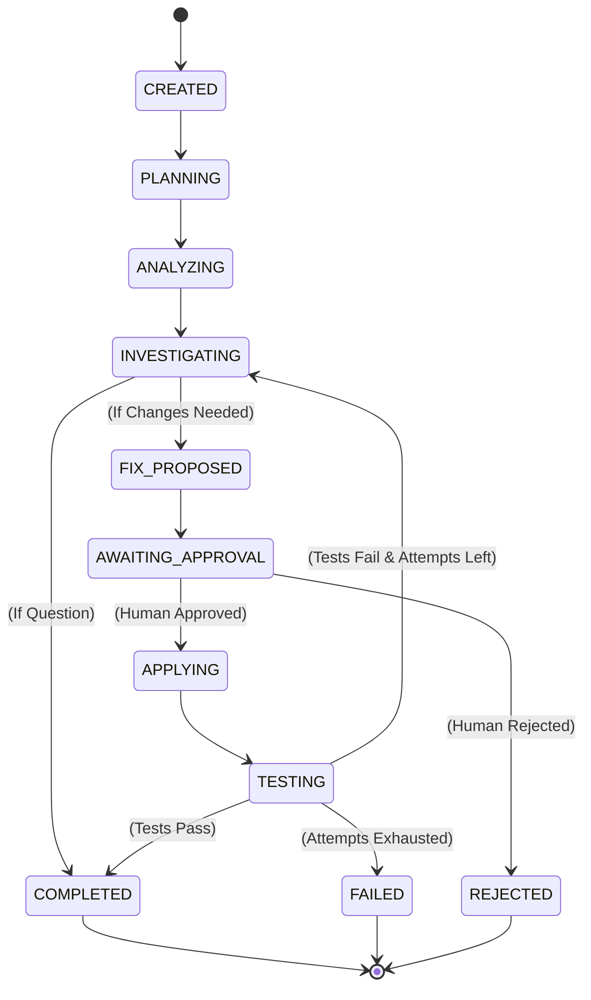

# Task State Machine & Approval Lifecycle

DevAgent governs every task through a deterministic state machine defined in `app/orchestration/state_machine.py`.

## Lifecycle Diagram

## Capability Mapping

Permissions are strictly scoped by state (`permissions_for_status` in `app/tools/permissions.py`):

| Task Status | Granted Permissions | Description |
|---|---|---|
| `CREATED`, `PLANNING`, `ANALYZING` | `READ` | Code search, list files, symbol lookup |
| `INVESTIGATING` | `READ`, `EXECUTE` | Read codebase, run sandboxed tests/diagnostics |
| `AWAITING_APPROVAL` | `READ` | Pipeline paused waiting for human review |
| `APPLYING` | `READ`, `WRITE`, `EXECUTE` | Write files, apply patches to workspace |
| `TESTING` | `READ`, `EXECUTE` | Sandboxed test execution and verification |
| `COMPLETED`, `FAILED` | `READ` | Terminal state audit |
